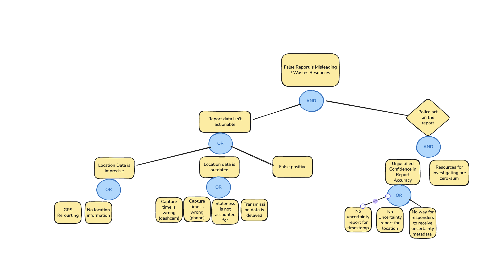

## Fault Tree Drawing

## Fault Tree Mitigations
**Mitigation Strategy #1**: Require reports include **confidence** intervals for both the sighting itself, but also confidence for the **location** and **timestamp** that are sent to emergency dispatchers. Establishing these connections and ensuring responders have access to meta-data transforms an 'OR' into an 'AND' in the far-right column because in a circumstance where a report has a GAP in a core area (e.g., metadata for location is sporadic and the system has low confidence in reporting the credibility of the dashcam sighting), then dispatchers and responders can act accordingly and carefully. This reduces unjustified  confidence in the model and a reported sighting.

**Mitigation Strategy #2** Building in redundancy in timestamp reporting through cross-verification. There are numerous possible areas of clock failure: dashcam clock and cellphone clock. By building redundancy among them, we can be more confidant in the time of our report. This would transform capture time is wrong (dashcam) and capture time is wrong (phone)by combining them into a new bubble "capture time can't be coordinated/verified" .Effectively, this transforms an "or" into an "and" by combining two faults of failure and replaces it with another (in the new system, we would prefer the time that matches the information from the cell tower handling the data).